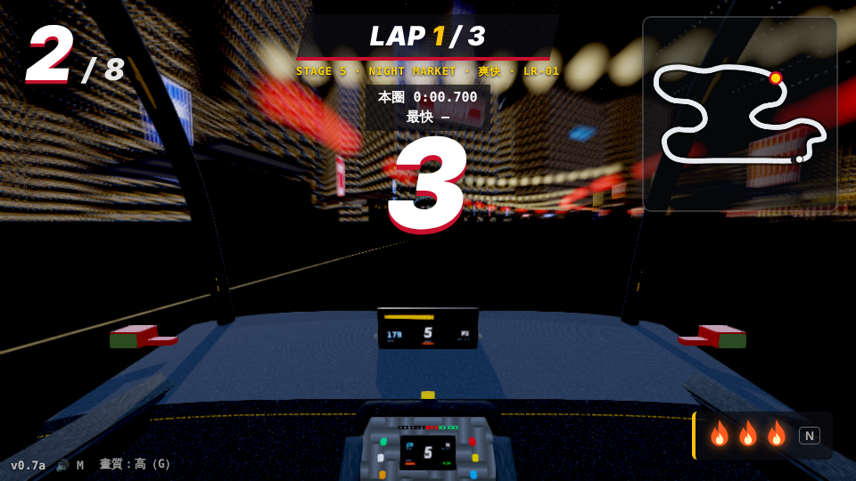
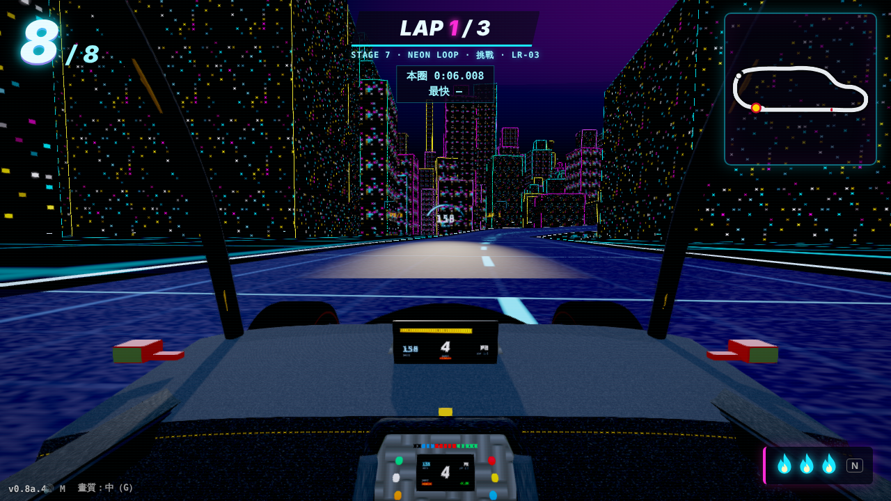
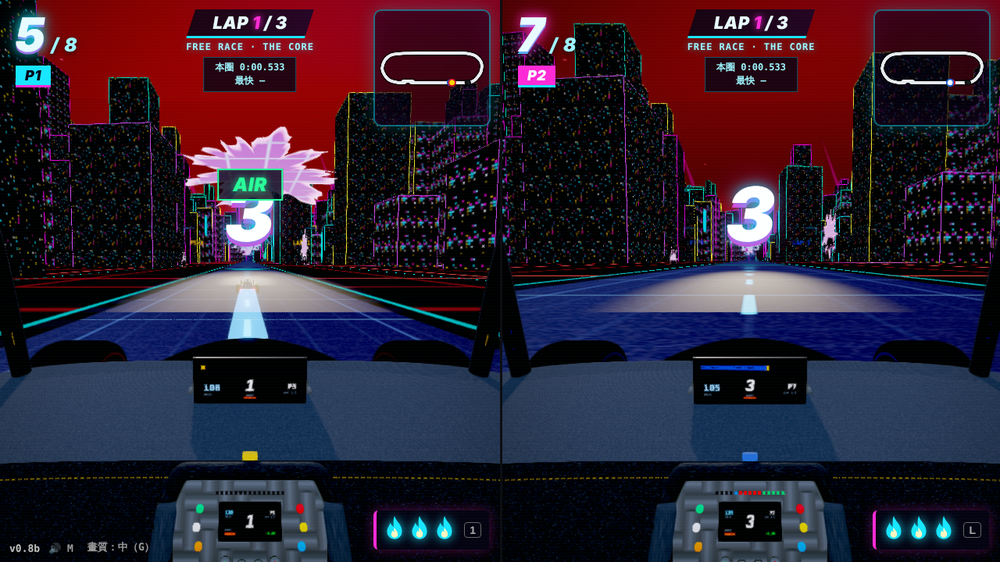

# Teen Game Dev Mentor

[繁體中文](README.md) | **English**

An AI mentor skill for teenagers (and anyone building software for the first time): **without writing a single line of code**, take a single-page browser game from idea to public launch by conversation alone, while learning to think like a software product owner and to work with AI.

> This skill does not teach programming. It teaches: think before building, describe requirements in measurable terms, judge completion by evidence, record every change, test before shipping, know the cost before changing anything; and how to get an AI to write a spec and then spot where it isn't what you meant, how to challenge an AI's evidence rather than its verdict, and how to brainstorm with an AI to make things you couldn't have imagined.

## Where it comes from

The method was built on two real projects completed by a non-programmer through conversation alone:

1. A WWII toy-soldier 3D wave-defence shooter, taken to a public playtest.
2. **Racing Lucas**: a 9-stage first-person 3D racing game (three.js, single HTML file, playable offline) with twenty-plus versions, 84 acceptance criteria, split-screen two-player, a rail engine (vertical loops, 720° corkscrew, inverted ceiling, jump gaps) and a champion ending.

The second project pushed the process to its limits; half the rules in the skill were learned from holes it fell into. For instance, "the AI must never verify its own fix with the same assumptions" comes from a direction sign error that took four versions to find. `examples/racing-lucas/` holds that project's real documents (SPEC, CHANGELOG, TESTPLAN, HANDOFF, in Traditional Chinese).

## Play Racing Lucas

🎮 **https://lucasracing.netlify.app/** — open in a desktop browser (keyboard: arrows / WASD, Space handbrake, Shift boost; G quality, F fps counter). Works offline too: the whole game is one HTML file.

| Stage 5 Night Market | Stage 7 NEON LOOP |
|---|---|
|  |  |
| **Stage 9 THE CORE (final-lap overload)** | **Split-screen two-player** |
|  |  |

Not one line of code in these screens was written by the product owner; what he wrote was the 84 acceptance criteria in `examples/racing-lucas/SPEC.md` and the bug / feel reports for every version.

## Core design

| Mechanism | Problem it solves |
|---|---|
| **Six stations** (kick-off → spec → build → verify & iterate → public deploy → wrap-up & handoff) | One file and one concept per station; small and complete, not big and polished |
| **Two-tier knowledge cards** | Terms are explained at the moment a decision needs them (decision card); others are listed at the bottom of a reply, expanded on request; all accumulate in `GLOSSARY.md` |
| **Three-tier boundary for challenging evidence** | First failed fix: practise report quality. Second: the AI must admit its verification may be blind, diagnose only. Third: halt and re-examine assumptions |
| **Quote before touching anything** | On any bug or request the AI first states what changes, the scale and how many rounds, then waits for go; saves tokens and teaches the cost of decisions |
| **★ AI proposal slot** | Every SPEC version reserves room for ideas the learner didn't think of, with references and cost; 1+1>2 as a process, not luck |
| **Scale gatekeeper** | When a single page can't hold it (>1 MB, needs a server, system-level asks) the AI declines the order and helps define scale, cut an MVP, or graduate |
| **Graduation = five observable behaviours** | Not "can write a spec" but can review one, reject with reasons, classify feedback, ask for evidence, issue scoped orders |
| **HANDOFF.md at the end of every conversation** | Conversations vanish, get compressed, change models; files are the save game |

## Install

### Claude (claude.ai / Claude Code)
- **claude.ai**: download `skills/teen-game-dev-mentor-en/` (or the Traditional Chinese `skills/teen-game-dev-mentor/`) and upload the folder on the Skills settings page. Team / Enterprise admins can publish it to the whole organisation.
- **Claude Code**: copy the folder into `~/.claude/skills/`, or use an installer that supports the Agent Skills standard:
  ```bash
  npx skills add X0xZaX/teen-game-dev-mentor
  ```

### Other models (ChatGPT, Gemini, local models…)
`SKILL.md` is plain Markdown. Remove the frontmatter between the `---` lines at the top and paste the rest as the system prompt or custom instructions. The body depends on no Claude-specific tools; it only assumes the model can produce a single HTML file and Markdown documents. If the model doesn't keep the status box at the end of replies, remind it once in the first turn.

## Getting started

Say to the AI:

> I want to make a game.

That's it. The skill introduces itself, issues the first knowledge card, asks three questions and starts Station 0.

Returning with an existing project: upload `SPEC.md`, `CHANGELOG.md`, `HANDOFF.md`, `GLOSSARY.md` and the latest HTML, and state the request in build-order format:

> Based on SPEC v3, build v0.4, meeting acceptance criteria 12 to 15, delivering one HTML file.

## Layout

```
skills/
  teen-game-dev-mentor/SKILL.md      ← Traditional Chinese
  teen-game-dev-mentor-en/SKILL.md   ← English
templates/                           ← blank SPEC / TESTPLAN / CHANGELOG / HANDOFF / delivery-report templates (both languages)
examples/racing-lucas/               ← real project documents: SPEC v8, CHANGELOG, TESTPLAN, HANDOFF
```

## For parents and teachers

- The skill assumes the learner is a minor: before going live it checks that no real names, school or photos are included; when an account is needed (Netlify) it asks that a parent creates it.
- It never decides for the kid. Every fork gets 2–3 options with their costs; the kid chooses.
- It is cost-aware: it asks about budget at the start of each conversation and quotes before working. Say "go light today" to throttle.

## License

MIT. Fork it, translate it, make it your own; if you use it to help a kid ship a game, we'd love to hear about it.
